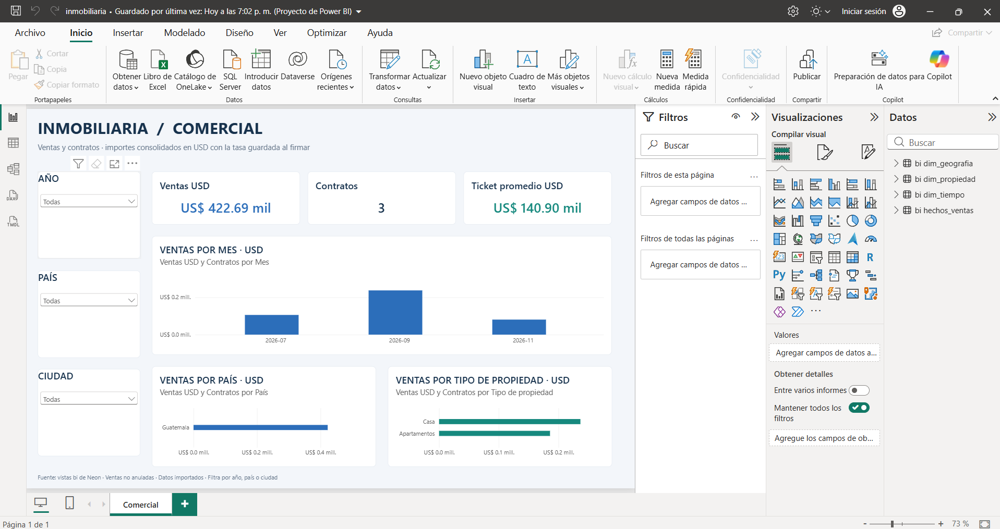

# Manual técnico

Sistema de gestión para una agencia inmobiliaria latinoamericana. Proyecto final
del curso Programación Comercial, Universidad Mesoamericana, Quetzaltenango.

> **Borrador.** La estructura es una propuesta para todo el equipo. Cada
> integrante completa su sección. Las marcadas *Pendiente* no se han escrito.

---

## 1. Descripción general

El sistema registra el ciclo de cada propiedad: compra, construcción,
documentación, avalúos, cotizaciones, venta y arrendamiento. Incluye un agente
de IA con recuperación de documentos, mensajería asíncrona, reportes exportables
y bitácoras de auditoría.

El frontend React consume una API Django REST con PostgreSQL. Los roles
controlan las operaciones y, para agentes comerciales, la cartera del cliente
limita tanto los detalles como los totales. Los contratos conservan sus tasas
de cambio para que una nueva tasa no modifique las cifras históricas.

La entrega se verifica por bloques: catálogo y flujo comercial, compras y
construcción, asistente con documentos, procesamiento asíncrono con RabbitMQ,
dos bitácoras, quince reportes con Excel/PDF e integración analítica mediante
cuatro vistas `bi`, que el tablero `docs/powerbi/inmobiliaria.pbix` lee con el
usuario de solo lectura `powerbi_reader` (verificado en producción, §11).

## 2. Arquitectura

| Capa | Tecnología |
|---|---|
| Backend | Python 3.12, Django 5, Django REST Framework |
| Base de datos | PostgreSQL 16 con pgvector |
| Mensajería | RabbitMQ y Celery |
| Frontend | React 19, Vite y TypeScript |
| Despliegue | Render, Neon, CloudAMQP y Vercel |

Cada dominio es una app de Django, con las mismas capas:

```
views.py / serializers.py   HTTP: valida la entrada y formatea la salida
services.py                 escrituras: reglas de negocio y transacciones
selectors.py                lecturas: consultas y agregaciones
models.py                   datos: campos y constraints
```

El detalle está en `docs/arquitectura.md`, y las entidades en
`docs/modelo-datos.md`.

### 2.1 Cómo se conectan las piezas en producción

```
Navegador ──► Vercel (React)          proyecto-inmobiliaria-chi.vercel.app
    │
    └── HTTPS + JWT ──► Render: un contenedor   inmobiliaria-api-x8gr.onrender.com
                         ├─ gunicorn (API de Django)
                         └─ worker de Celery ◄── colas celery y documentos
                              │       │
             PostgreSQL ◄─────┘       └────► RabbitMQ
             Neon, con pgvector              CloudAMQP
                              │
             Supabase Storage (documentos oficiales, privado)
             Gemini (agente y embeddings, solo desde apps/ia/proveedores/)
```

La API y el worker comparten un contenedor para caber en el plan gratuito de
Render. El detalle y las alternativas descartadas están en
`specs/002-despliegue.md`; la operación, en la §12.

## 3. Instalación

```bash
docker compose up -d                 # PostgreSQL con pgvector y RabbitMQ
cd backend
python -m venv .venv
.venv\Scripts\activate               # Windows; en Linux: source .venv/bin/activate
pip install -r requirements/dev.txt
python manage.py migrate
python manage.py seed_demo
python manage.py runserver
```

En otra terminal, el worker. Con `-Q` consume las dos colas: sin ella, la
indexación de los documentos del agente se queda esperando (§8).

```bash
celery -A config worker -Q celery,documentos -l info
```

Y el frontend:

```bash
cd frontend
npm install
npm run dev
```

**Variables de entorno:**
- **Backend:** se copian de `.env.example` a `.env`, en la raíz.
- **Frontend:** se copian de `frontend/.env.example` a `frontend/.env`; basta
  `VITE_API_URL=http://localhost:8000/api/v1`.

Ningún secreto va en el repositorio. Las de producción están en la §12.

**Pruebas:** `pytest`, desde `backend/`. En Windows fallan las pruebas que
generan PDF, porque WeasyPrint necesita librerías GTK; en la imagen de Docker
pasan.

## 4. Catálogo, avalúos y documentos (rol A)

### 4.1 Entidades

| Entidad | Qué es |
|---|---|
| `TipoPropiedad` | Siete tipos de la migración (casa, terreno, apartamentos…). `requiere_unidades` dice si se vende por unidades |
| `Propiedad` | El bien: tipo, ciudad, áreas, precio de lista con su moneda, estado y `es_publica` |
| `Unidad` | Un apartamento o local de una propiedad que requiere unidades |
| `Avaluo` | Una valuación con fecha, valor, moneda, perito y metodología |
| `DocumentoOficial` | Escritura, licencia, plano, certificación, avalúo, contrato u otro, con su archivo |
| `ImagenPropiedad` | Una foto de la galería de la propiedad, con su orden y la marca de portada |

Reglas completas: `specs/003-catalogo-propiedades.md`,
`specs/011-avaluos-documentos.md` y `specs/019-imagenes-propiedad.md`.
Pantallas: `specs/014-pantallas-catalogo.md`.

### 4.2 Reglas que más se preguntan

- **El código `PROP-00001` lo pone el sistema** y no cambia.
- **Un edificio no se vende ni se arrienda entero:** se venden sus unidades.
  Por eso los reportes cuentan como bien la unidad, no el edificio.
- **El estado solo cambia por `cambiar_estado_propiedad` o
  `cambiar_estado_unidad`.** Esa función bloquea la fila (`select_for_update`) y
  acepta `estado_requerido`: si otro proceso cambió el bien mientras tanto,
  responde 409 `PROPIEDAD_NO_DISPONIBLE`. Ventas, arrendamientos, compras y
  construcción la usan, así dos contratos no toman el mismo bien.
- **Estados:** `EN_NEGOCIACION` (el inicial), `ADQUIRIDA`, `EN_CONSTRUCCION`,
  `DISPONIBLE`, `RESERVADA`, `VENDIDA`, `ARRENDADA` y `BAJA`.
- **Nada se borra:** desactivar marca `activo` en falso. Una propiedad con
  unidades activas no se desactiva (409).
- **Los avalúos no se editan:** el historial es la plusvalía. Uno equivocado se
  desactiva y se registra otro.
- **Documentos:**
  - solo PDF, JPG o PNG de hasta 10 MB, revisados por su contenido y no solo
    por la extensión;
  - se guardan con un nombre generado (`documentos/PROP-00001/<uuid>.pdf`);
  - en producción van a un bucket privado de Supabase, y se descargan con una
    URL firmada que vence a los 5 minutos;
  - un documento que respalda un avalúo activo no se desactiva (409).
- **Imágenes (spec 019):**
  - JPG o PNG de hasta 5 MB, con la misma revisión por contenido que los
    documentos (`_validar_archivo` recibe las firmas y el tamaño);
  - hasta 10 activas por propiedad (409 `LIMITE_IMAGENES`);
  - una sola portada activa, garantizada por un `UniqueConstraint` con
    condición: la primera foto es la portada, y al desactivarla la marca pasa
    a la siguiente según el orden;
  - la API entrega cada foto con su URL firmada de 5 minutos. La lista de
    propiedades trae `portada_url` con un `Prefetch`, sin una consulta por
    fila.

### 4.3 Permisos

Escriben `ADMINISTRADOR` y `GERENTE`; los tipos de propiedad, solo
`ADMINISTRADOR`. Todos los roles autenticados leen y descargan.

### 4.4 API y pantallas

| Recurso | Ruta |
|---|---|
| Tipos de propiedad | `/api/v1/tipos-propiedad/` |
| Propiedades | `/api/v1/propiedades/` (filtros por tipo, ciudad, país, estado, precio y `?buscar=`) |
| Cambiar estado | `/api/v1/propiedades/{id}/cambiar-estado/` y `/api/v1/unidades/{id}/cambiar-estado/` |
| Unidades | `/api/v1/propiedades/{id}/unidades/` (`?buscar=` por código) |
| Avalúos | `/api/v1/propiedades/{id}/avaluos/` |
| Documentos | `/api/v1/propiedades/{id}/documentos/` (multipart) y `/api/v1/documentos/{id}/descarga/` |
| Imágenes | `/api/v1/propiedades/{id}/imagenes/` (multipart), `/api/v1/imagenes/{id}/` y `/api/v1/imagenes/{id}/marcar-portada/` |

En el frontend, la **ficha de la propiedad** (`/catalogo/propiedades/{id}`)
reúne todo en pestañas: Datos (con el último avalúo), Unidades, Avalúos,
Documentos e Imágenes. La lista de propiedades muestra la miniatura de la
portada. Los vencidos se ven en rojo y los que vencen en 30 días, en ámbar.
La pestaña va en la URL (`?pestana=documentos`), así se puede compartir.

## 5. CRM, ventas y arrendamientos (rol B)

### 5.1 Entidades

| App | Entidades |
|---|---|
| `crm` | `Cliente`, `Agente`, `Cotizacion` |
| `ventas` | `ContratoVenta`, `CuotaPago` |
| `arrendamientos` | `ContratoArrendamiento`, `PagoRenta` |

Reglas completas: `specs/004-crm-clientes-agentes.md`,
`specs/007-cotizaciones-ventas.md` y `specs/008-arrendamientos.md`. Pantallas:
`specs/012-pantallas-bloque-b.md`.

### 5.2 Flujo de una venta

```
BORRADOR → ENVIADA → APROBADA → contrato VIGENTE → LIQUIDADO
                  ↘ RECHAZADA
```

| Paso | Servicio | Efecto en el bien |
|---|---|---|
| Aprobar cotización | `aprobar_cotizacion` | De `DISPONIBLE` a `RESERVADA` |
| Rechazar una aprobada | `rechazar_cotizacion` | De `RESERVADA` a `DISPONIBLE` |
| Firmar contrato | `firmar_contrato` | A `VENDIDA` |
| Anular contrato sin pagos | `anular_contrato` | De `VENDIDA` a `DISPONIBLE` |

- Un contrato se firma desde una cotización aprobada o sin ella.
- De contado, nace `LIQUIDADO` y sin cuotas.
- Financiado, genera cuotas fijas por sistema francés:
  `cuota = P · i / (1 − (1 + i)^−n)`. La última ajusta los centavos.
- Un pago puede ser parcial. Al pagar la última cuota, el contrato pasa a
  `LIQUIDADO`.

### 5.3 Flujo de un arrendamiento

| Acción | Servicio | Efecto |
|---|---|---|
| Firmar | `firmar_arrendamiento` | Genera todos los pagos; el bien pasa a `ARRENDADA` |
| Cobrar | `registrar_pago_renta` | Pago completo, con recargo si pasó la gracia |
| Renovar | `renovar_arrendamiento` | Contrato nuevo; el anterior queda `RENOVADO` |
| Rescindir | `rescindir_arrendamiento` | Cancela los pagos posteriores; el bien queda `DISPONIBLE` |
| Finalizar | `finalizar_arrendamiento` | Pasa a `VENCIDO`; el bien queda `DISPONIBLE` |

### 5.4 Permisos

| Rol | Clientes y cotizaciones | Firmar | Registrar pagos | Anular, rescindir o finalizar |
|---|---|---|---|---|
| `ADMINISTRADOR`, `GERENTE` | Todos | Sí | Sí | Sí |
| `AGENTE` | Su cartera | En su cartera | No | No |
| `CONTABILIDAD` | Lectura | No | Sí | No |
| `CONSULTA` | Lectura | No | No | No |

La cartera se aplica en `listar_clientes_visibles`. Un agente que pide algo ajeno
recibe 404, no 403, para no confirmar que existe.

### 5.5 Decisiones de diseño

- **La mora y el vencimiento se calculan.** No se guardan, para que nunca queden
  desactualizados.
- **Cada contrato y pago guarda su tasa al dólar.** Así un reporte no recalcula
  el pasado.
- **La comisión se guarda al firmar.** Con cotización, es del agente que cotizó.
- **Los contratos no se borran.** Anular es un estado.
- **Toda escritura se audita** con `registrar_auditoria`, dentro de la misma
  transacción.
- **`select_for_update`** protege los pagos simultáneos: el segundo espera y lee
  el saldo que dejó el primero.

### 5.6 API

| Recurso | Ruta |
|---|---|
| Clientes | `/api/v1/clientes/` |
| Agentes | `/api/v1/agentes/` |
| Cotizaciones | `/api/v1/cotizaciones/` |
| Contratos de venta | `/api/v1/contratos-venta/` |
| Contratos de arrendamiento | `/api/v1/contratos-arrendamiento/` |

La documentación completa de cada endpoint está en `/api/docs/`.

### 5.7 Datos de demostración

`seed_demo` carga agentes, clientes, contratos y cotizaciones ficticios, con
fechas relativas a hoy, para que siempre haya cuotas pagadas, parciales y en
mora. Las unidades `A-103` y `A-203` quedan libres para mostrar una venta en
vivo. Los comandos no duplican datos.

## 6. Compras y construcción (rol C)

### 6.1 Entidades

| App | Entidad | Qué es |
|---|---|---|
| `compras` | `Proveedor` (`PRV-0001`) | Quien le vende una propiedad a la agencia: propietario particular, inmobiliaria, banco, gobierno u otro |
| `compras` | `ContratoCompra` (`CC-00001`) | La compra de una propiedad a un proveedor, con monto, gastos legales, impuestos y costo total |
| `construccion` | `Constructora` (`CST-0001`) | Empresa que construye; calificación opcional de 1 a 5 |
| `construccion` | `ProyectoConstruccion` (`PC-00001`) | La obra sobre una propiedad: presupuesto, fechas, estado y avance |
| `construccion` | `PagoConstructora` (`PG-00001`) | Un pago a la constructora de un proyecto: anticipo, avance, finiquito o extra |

Reglas completas: `specs/006-proveedores-constructoras.md` y
`specs/017-compras-construccion-contratos.md`. Pantallas:
`specs/018-pantallas-bloque-c.md`.

### 6.2 El ciclo de una propiedad que se compra y se construye

```
EN_NEGOCIACION ──completar contrato──► ADQUIRIDA ──iniciar obra──► EN_CONSTRUCCION ──finalizar──► DISPONIBLE
                                           ▲                              │
                                           └────── cancelar obra ─────────┘
```

| Paso | Servicio | Efecto en la propiedad |
|---|---|---|
| Registrar contrato | `crear_contrato_compra` | Ninguno: el contrato nace `EN_PROCESO` |
| Completar contrato | `completar_contrato_compra` | De `EN_NEGOCIACION` a `ADQUIRIDA` |
| Anular contrato | `anular_contrato_compra` | Ninguno: sigue en negociación y admite otro contrato |
| Registrar proyecto | `crear_proyecto` | Ninguno: el proyecto nace `PLANIFICADO` |
| Iniciar | `iniciar_proyecto` | De `ADQUIRIDA` a `EN_CONSTRUCCION` |
| Finalizar (avance 100) | `finalizar_proyecto` | A `DISPONIBLE`, y sus unidades `EN_NEGOCIACION` o `EN_CONSTRUCCION` también |
| Cancelar | `cancelar_proyecto` | De `EN_CONSTRUCCION` a `ADQUIRIDA`; anula los pagos programados |

Estados de un proyecto: `PLANIFICADO` → `EN_EJECUCION` ⇄ `SUSPENDIDO` →
`FINALIZADO`, o `CANCELADO` desde cualquiera de los activos. Todos los cambios
de la propiedad pasan por `cambiar_estado_propiedad` del catálogo, con
`estado_requerido`.

### 6.3 Reglas que más se preguntan

- **El costo total lo calcula el sistema:** monto + gastos legales + impuestos.
  El usuario nunca lo envía.
- **Una propiedad tiene como máximo un contrato no anulado y un proyecto
  activo.** Lo garantizan `UniqueConstraint` con condición en la base, no solo
  el código: dos peticiones al mismo tiempo no pasan las dos.
- **El presupuesto no se supera; se sube.** Lo programado y lo pagado no puede
  pasar del presupuesto (409 `PRESUPUESTO_EXCEDIDO`). La salida es editar el
  presupuesto, que queda en la bitácora con el valor anterior y el nuevo: esa
  es la "autorización explícita".
- **El avance nunca baja** y va de 0 a 100. Cada avance queda en la bitácora
  con su descripción.
- **El finiquito se programa solo con la obra finalizada.** El anticipo es el
  único pago que se puede pagar antes del inicio de la obra.
- **Editar un proyecto:** uno activo cambia nombre, fecha de fin estimada y
  presupuesto; uno finalizado, solo el presupuesto (para un finiquito que no
  cabía); uno cancelado, nada.
- **Contratos y pagos no se editan ni se borran.** Un error se anula, con
  motivo, y se registra de nuevo.
- **Un proveedor con un contrato en proceso, o una constructora con un
  proyecto activo, no se desactiva** (409).
- **NIT:** obligatorio para constructoras y para todo proveedor menos el
  propietario particular. Se guarda normalizado y no se repite en un país.

### 6.4 Permisos

| Rol | Proveedores, constructoras, contratos y proyectos | Pagos a constructoras |
|---|---|---|
| `ADMINISTRADOR`, `GERENTE` | Escriben | Programan, pagan y anulan |
| `CONTABILIDAD` | Lectura | Programan, pagan y anulan |
| `AGENTE`, `CONSULTA` | Lectura | Lectura |

Contabilidad registra pagos, pero no decide compras ni obras: mismo criterio
que las cuotas de ventas.

### 6.5 Decisiones de diseño

- **Cada contrato, proyecto y pago guarda su tasa al dólar** (`tasa_a_usd`) y
  el monto convertido. El contrato, con la tasa de su fecha de compra; el pago,
  con la del día en que se paga. Así un reporte en dólares no cambia el pasado.
- **`total_comprometido` y `disponible` los calcula la API**, con el mismo
  selector que valida el presupuesto. La pantalla nunca suma los pagos, para
  que la validación y lo que se ve no den números distintos.
- **`select_for_update` en cada acción:** dos pagos simultáneos no pasan juntos
  el presupuesto, y dos peticiones no completan el mismo contrato.
- **El pago no guarda la constructora:** la toma del proyecto, para que un pago
  nunca vaya a otra constructora que la de su obra.
- **Sin entidad `AvanceObra`:** el historial de avances vive en la bitácora.
- **Las apps no dependen entre sí:** `obtener_dolar` tiene su copia en cada
  app, y lo común lo da el catálogo.

### 6.6 API y pantallas

| Recurso | Ruta |
|---|---|
| Proveedores | `/api/v1/proveedores/` (filtros por tipo, país, ciudad y `?buscar=`) |
| Contratos de compra | `/api/v1/contratos-compra/`, con `/completar/` y `/anular/` |
| Constructoras | `/api/v1/constructoras/` (filtros por país, `?calificacion_min=` y `?buscar=`) |
| Proyectos | `/api/v1/proyectos-construccion/`; el detalle trae `total_comprometido` y `disponible` |
| Acciones del proyecto | `.../{id}/iniciar/`, `avance/`, `suspender/`, `reanudar/`, `finalizar/` y `cancelar/` |
| Pagos de un proyecto | `/api/v1/proyectos-construccion/{id}/pagos/` |
| Pagos | `/api/v1/pagos-constructora/`, con `/{id}/pagar/` y `/{id}/anular/` |

En el frontend, compras (`/compras/proveedores`, `/compras/contratos`) y
construcción (`/construccion/constructoras`, `/construccion/proyectos`) siguen
el patrón de B: listas con filtros en la URL y formularios con
`FormularioDatos`. El **detalle del proyecto** (`/construccion/proyectos/{id}`)
reúne los datos, la barra de avance, presupuesto / comprometido / disponible,
los pagos y las acciones. Cada acción aparece solo en el estado que la admite y
para el rol que la puede hacer. Los formularios de compra y de obra ofrecen solo
las propiedades en negociación o adquiridas.

### 6.7 Datos de demostración

`cargar_demo_compras` y `cargar_demo_construccion` (dentro de `seed_demo`,
después del catálogo) dejan:

- seis proveedores y cuatro constructoras;
- el terreno Las Lomas con un contrato en proceso, listo para completarlo en
  vivo;
- la gasolinera adquirida, con un proyecto planificado, para iniciarlo;
- el hotel en obra al 60 %, con sus pagos, para registrar avance y finalizarlo.

Se guardan como una foto del estado que ya tiene cada propiedad en la demo del
catálogo, sin auditoría, igual que el resto de la demo.

## 7. Agente de IA y RAG (rol C)

### 7.1 Qué hace

Un visitante, sin iniciar sesión, le pregunta al asistente (`/asistente`) por la
agencia: servicios, requisitos, horarios. El agente responde **solo** con los
documentos de la agencia, cita de dónde salió cada dato y, si no encuentra nada,
lo dice sin inventar. Reglas completas: `specs/005-agente-ia-rag.md`; bitácora:
`specs/015-bitacora-agente-ia.md`; pantalla: `specs/018-pantallas-bloque-c.md`;
carga asíncrona de documentos: §8 de este manual.

### 7.2 Entidades

| Entidad | Qué es |
|---|---|
| `DocumentoRAG` | Un documento en Markdown: título único, versión, estado de indexación y fecha |
| `FragmentoRAG` | Un trozo del documento con su sección y su vector (`vector(768)`, índice HNSW por distancia coseno) |

Los vectores viven en la misma PostgreSQL, con pgvector: no hay otra base de
datos que administrar.

### 7.3 Cómo se responde una pregunta

```
pregunta ──► vector (Gemini, 768 valores) ──► 5 fragmentos más cercanos con distancia ≤ 0.42
                                                   │
                     ┌──────── ninguno ────────────┴──────── alguno ─────────┐
                     ▼                                                       ▼
        "No encontré información…"                   fragmentos numerados + instrucciones ──► Gemini
        (sin llamar al modelo)                                                │
                                                     respuesta con [n] ──► solo las citas usadas
```

1. **Indexar** (`indexar_documento`): el Markdown se parte por sus encabezados
   `##`, en trozos de hasta 1,500 caracteres, y cada trozo se convierte en
   vector, de 100 en 100. Los vectores se piden **fuera** de la transacción; si
   el documento cambió mientras tanto, se descarta el resultado
   (`DocumentoModificadoDuranteIndexacion`).
2. **Buscar:** se buscan los 5 fragmentos más cercanos con distancia coseno de
   hasta 0.42 (`IA_DISTANCIA_MAXIMA`).
3. **Sin fragmentos, no se llama al modelo:** responde `sin_informacion` con
   0 tokens. No gasta cuota ni le da ocasión de inventar.
4. **Con fragmentos,** el modelo recibe las instrucciones de
   `apps/ia/instrucciones.py` (responder solo con los fragmentos, citar `[n]`,
   no inventar, no cambiar de tema) y los fragmentos numerados.
5. **Citas:** se devuelven solo los fragmentos que el modelo citó, con
   documento, sección y extracto. En la pantalla, cada `[n]` enlaza a su cita.

### 7.4 El proveedor de IA

- **Gemini en su capa gratuita,** para el chat (`IA_MODELO`, hoy
  `gemini-3.5-flash-lite`) y los embeddings (`gemini-embedding-001` con
  `output_dimensionality=768`).
- **El SDK `google-genai` solo se importa en `apps/ia/proveedores/gemini.py`.**
  El resto del sistema conoce la interfaz de `proveedores/base.py`, y
  `fabrica.py` elige la implementación: cambiar de proveedor es escribir otra
  clase, no tocar los servicios.
- **Reintentos:** tres intentos ante 429, 500, 503, 504 o un error de red, con
  esperas de 1 y 2 segundos y un límite de 30 segundos por petición. Un 400 o
  un 401 no se reintenta, porque no se arregla solo.
- **Sin llave** (`IA_API_KEY` vacía), el proveedor lanza
  `ProveedorIANoDisponible` y la API responde 503 `AGENTE_NO_DISPONIBLE`: el
  sistema arranca igual y la pantalla avisa que el asistente no está
  disponible.
- **Datos personales:** la capa gratuita usa lo que recibe para mejorar los
  productos de Google. Por eso la pantalla pide no escribir nombres, teléfonos
  ni documentos, y los documentos de la demo no tienen datos reales.

### 7.5 Bitácora del agente

Cada consulta, correcta o fallida, queda en la bitácora con
`registrar_consulta_agente` (spec 015): pregunta, respuesta, fragmentos
recuperados (documento, sección y distancia), tokens de entrada y de salida, y
tiempo.

- Tokens **0/0** cuando no se llamó al modelo.
- Tokens **vacíos** (`None`) si Gemini falló: no se sabe cuánto consumió.
- Si falla, `exito=False` con el diagnóstico, antes de responder 503. El
  diagnóstico lo arma el proveedor y nunca lleva la llave.

### 7.6 Seguridad y límites

- `POST /api/v1/agente/consultas/` es **público**, con un límite de
  **10 consultas por minuto** por visitante (`ScopedRateThrottle`). Al pasarlo
  responde 429 con `espera_segundos`, y la pantalla dice cuánto esperar.
- Las instrucciones del modelo le prohíben salirse de los documentos aunque se
  lo pidan.

### 7.7 Datos de demostración

`cargar_demo_ia` (dentro de `seed_demo`) carga cuatro documentos de la agencia
desde `apps/ia/documentos_demo/` y los indexa. Es idempotente. Sin llave, los
carga sin indexar, y la indexación se puede repetir desde *Documentos del
asistente* cuando haya llave.

## 8. Mensajería (rol A, spec 020)

El flujo con RabbitMQ es **la ingesta de los documentos del agente**: subir o
reemplazar un documento encola su indexación. La API responde enseguida, y el
worker trocea el texto, pide los vectores a Gemini e indexa.

```
Gerente sube un .md ──► API: guarda el documento PENDIENTE
                         └─ al confirmar la transacción (on_commit)
                              └─► RabbitMQ, cola "documentos"
                                   └─► worker: ia.indexar_documento
                                        ├─ trocea, pide vectores, guarda fragmentos → INDEXADO
                                        └─ si Gemini falla: reintenta a 1, 2 y 4 minutos → ERROR
```

**Decisiones que se defienden:**
- **`transaction.on_commit`:** se encola solo si la transacción se confirma. El
  worker nunca busca un documento que todavía no existe, y si algo falla no
  queda un mensaje huérfano.
- **El estado vive en el documento** (`PENDIENTE`, `INDEXADO`, `ERROR`), no en
  un backend de resultados. Así no hace falta Redis, que se dejó fuera.
- **`acks_late`:** el mensaje se confirma al terminar. Si Render reinicia el
  worker a mitad de una tarea, RabbitMQ lo entrega de nuevo. Repetir es seguro,
  porque indexar reemplaza los fragmentos.
- **Reindexar vale en cualquier estado**, para que ningún documento quede
  atascado.
- **La tarea es una cáscara:** recibe el id y llama a `indexar_documento`; la
  lógica vive en el servicio.

**Dónde se ve:** la pantalla *Documentos del asistente*
(`/asistente/documentos`, administración y gerencia). Sube un `.md` y el estado
pasa de Pendiente a Indexado; mientras hay pendientes recientes, la lista se
actualiza cada 5 segundos. En el log de Render aparece `ia.indexar_documento`
recibida en la cola `documentos`.

**Cuota:** CloudAMQP gratuito da 1 millón de mensajes al mes; cada subida es un
mensaje. El worker corre sin eventos de monitoreo, que serían mensajes extra.

Las notificaciones por correo (cola `notificaciones`) quedaron fuera de esta
entrega.

## 9. Auditoría

Hay dos registros separados e inmutables en la aplicación:

- `LogAuditoria` (`auditoria_log_sistema`): usuario, entidad e ID, acción,
  valores anteriores/nuevos, IP, user-agent y fecha. Los servicios registran
  escrituras de negocio junto con su transacción. Un fallo no debe dejar una
  escritura de negocio parcial.
- `LogAgenteIA` (`auditoria_log_agente`): pregunta, respuesta, modo, usuario,
  herramientas, documentos recuperados, tokens, duración y resultado. `null`
  en tokens significa desconocido; cero significa consumo conocido de cero.

Los modelos rechazan edición/borrado y el admin permite consulta. No se usan
`QuerySet.update/delete` sobre estas bitácoras en la aplicación. R17 permite
a administración consultar/exportar fecha, usuario, entidad y acción, sin
exponer IP, user-agent ni los JSON completos.

Cada abono de cuota deja un evento con su monto, fecha efectiva y tasa. R12
lee esos campos y concilia su suma con `CuotaPago.monto_pagado`. Esto permite
separar pagos de meses diferentes sin atribuir todo al último pago.

## 10. Reportes

Una sola pantalla `/reportes` construye filtros y columnas a partir del
catálogo. Los serializers validan parámetros; los selectores consultan y
agregan en PostgreSQL; los servicios comprueban permisos y eligen página o
exportación; los exportadores solo reciben el objeto `Reporte`.

JSON devuelve 25 filas por página y totales de todo el conjunto filtrado.
Excel y PDF incluyen todas las filas del filtro aplicado, con límite de
5,000: si se supera, se rechaza antes de cargar detalle. El formulario conserva
por separado lo escrito y el filtro aplicado; las descargas usan este último.
Los importes JSON son texto decimal exacto. No se suman monedas originales
distintas; donde se consolida en USD se usa la tasa histórica correspondiente.

R05 muestra inventario disponible sin contar dos veces edificios y unidades;
R16 muestra documentos vencidos o próximos a vencer, y R17 la auditoría solo
para administración. La 021 completa el conjunto hasta quince con los reportes
de las secciones siguientes y R12.

### 10.0 Flujo de ingresos R12 (rol D)

`GET /api/v1/reportes/flujo-ingresos/`, más `/excel/` y `/pdf/`, para
administración, gerencia y contabilidad. Filtros: fecha efectiva desde/hasta
inclusive, país del bien, moneda y origen (`CONTADO`, `ENGANCHE`, `CUOTA`,
`RENTA`). Cada fila identifica origen e ID fuente, contrato, fecha, país,
moneda, recibido, tasa y recibido USD. Agrupa por mes/origen/moneda y presenta
el total USD, redondeado por cobro antes de sumar.

- Contado y enganche usan fecha de firma y tasa del contrato. Anulados no
  aportan cobros. No se agrega nuevamente el precio de una venta financiada.
- Cada abono usa el ID de su log, su fecha y su tasa, incluso si la cuota
  recibió otro abono en otro mes. La pareja origen/ID evita colisiones.
- Una renta pagada aporta `monto_pagado`, que ya incluye el recargo. No se
  suma otra vez el recargo ni se trata el depósito como ingreso.
- Si falta evidencia, hay una fecha/tasa inválida o los abonos no concilian,
  responde 409 `DATOS_INCOMPLETOS` en JSON y archivos. La conciliación usa
  toda la historia de las cuotas del país/moneda seleccionados: no se conoce
  a qué mes pertenece un log ausente, por lo que acotar fechas no lo oculta.

Ejemplo: dos abonos de GTQ 100 y GTQ 200, con tasas USD 0.10 y 0.20, aportan
USD 10 y USD 40 en sus respectivas fechas: total USD 50, no USD 60.

### 10.1 Reportes comerciales (rol B)

| Código | Reporte | Contenido |
|---|---|---|
| R01 | Ventas por período | Contratos no anulados; totales por moneda, y por mes y país |
| R02 | Desempeño por agente | Cotizaciones, conversión, ventas y comisión |
| R03 | Embudo de cotizaciones | Conteos por estado y tasas |
| R04 | Ranking de clientes | Ordenado por venta en dólares, con saldos actuales |
| R10 | Estado de cuenta | Cuotas y rentas, con exigible, pagado y saldo |
| R11 | Morosidad | Deuda vencida por tramo y moneda |

Todos respetan la cartera, en el detalle y en los totales. Las reglas están en
`specs/021-reportes-restantes-power-bi.md`.

### 10.2 Reportes de catálogo, compras y obra (rol A)

| Código | Reporte | Contenido | Quién lo ve |
|---|---|---|---|
| R06 | Propiedades por estado | Cada bien, desde cuándo está en su estado (según la bitácora) y cuántos días lleva | Todos |
| R08 | Evolución de avalúos | Cada avalúo con el anterior comparable (misma propiedad y moneda) y su variación | Todos |
| R14 | Ocupación de arrendamientos | Bienes, arrendados y disponibles por propiedad; ocupación ponderada; renta vigente por moneda | Todos |
| R13 | Compras por proveedor | Compras completadas, con sus componentes de costo por proveedor, mes y moneda, y en USD | Administración, gerencia y contabilidad |
| R15 | Avance y presupuesto de obra | Presupuesto, programado, pagado, comprometido, disponible, saldo y atraso de cada proyecto | Administración, gerencia y contabilidad |

- **Sin dato es sin dato:** si un bien no tiene historia en la bitácora, R06
  deja la fecha vacía. No usa la última edición, que no dice cuándo entró al
  estado.
- **R14 pondera:** 2 arrendados de 5 bienes es 40 %, no el promedio de los
  porcentajes de cada propiedad.
- **R15 da los mismos números que el detalle del proyecto:** usa la misma
  regla de comprometido. Las sumas de pagos van en subconsultas: un `JOIN`
  contaría el presupuesto una vez por cada pago.

## 11. Power BI

### 11.1 Vistas del esquema `bi` (rol A)

La migración `reportes/0001_vistas_bi` crea cuatro vistas en modelo estrella:
`dim_tiempo`, `dim_geografia`, `dim_propiedad` y `hechos_ventas`. Son vistas,
no tablas: no copian datos.

Power BI se conecta con el rol `powerbi_reader`, que solo puede leer esas
vistas. Se crea con `docs/powerbi/crear_lector.sql`, a mano en Neon, y la
contraseña nunca va al repositorio. Las relaciones y la conexión están en
`docs/powerbi/README.md`.

### 11.2 Tablero

Se entrega `docs/powerbi/inmobiliaria.pbix` y su fuente editable
`inmobiliaria.pbip`. La página **Comercial** contiene tarjetas de ventas USD,
contratos y ticket promedio, gráficos por mes/país/tipo y filtros de
año/país/ciudad. Solo usa el USD guardado al firmar para sumar entre monedas.

Las medidas son `SUM('bi hechos_ventas'[neto_usd])`,
`COUNTROWS('bi hechos_ventas')` y `DIVIDE([Ventas USD], [Contratos])`.
Las tres relaciones son muchos-a-uno desde hechos a dimensiones, activas y
con filtro desde dimensión. No se mantiene una relación adicional entre
geografía y propiedad que cree rutas ambiguas.

Nathaly conectó Desktop a Neon con el lector, cargó las vistas, ejecutó
Actualizar, seleccionó meses, comprobó las respuestas cruzadas y guardó el
PBIX final. Las capturas muestran tres contratos sin selección y uno al
seleccionar julio, septiembre o noviembre. Los permisos negativos en
producción los confirmó Douglas por separado.



La evidencia y sus límites están en [powerbi/evidencia.md](powerbi/evidencia.md).
Queda para revisión la conciliación SQL de importes exactos en producción:
las tarjetas abrevian importes en miles. El procedimiento reproducible está
en `docs/powerbi/conciliacion.sql`; no se afirma haber ejecutado esas consultas
contra producción desde Codex. No se requiere publicar el tablero en la nube
para abrir el PBIX local de la entrega.

## 12. Despliegue (rol A, spec 002)

### 12.1 Servicios

| Pieza | Servicio, plan gratuito | Dirección |
|---|---|---|
| API y worker | Render, un contenedor Docker | `inmobiliaria-api-x8gr.onrender.com` |
| Frontend | Vercel | `proyecto-inmobiliaria-chi.vercel.app` |
| PostgreSQL 16 con pgvector | Neon | La de `DATABASE_URL` |
| RabbitMQ | CloudAMQP | La de `RABBITMQ_URL` |
| Documentos oficiales | Supabase Storage, bucket privado | Las variables `STORAGE_*` |
| Agente de IA | Gemini, capa gratuita | `IA_API_KEY` |

### 12.2 Cómo se publica una versión

1. Todo entra a `develop` por pull request.
2. Un pull request de `develop` a `main` es el release. Al fusionarlo, Render
   construye la imagen desde `backend/Dockerfile` y Vercel compila el frontend,
   los dos solos.
3. Render solo da la versión por buena cuando `/api/v1/health/` responde.

Al arrancar, `backend/scripts/iniciar.sh` hace, en orden:
1. Aplica las migraciones.
2. Crea el administrador inicial si no existe (`asegurar_administrador`).
3. Carga la demo (`seed_demo`) si `CARGAR_DATOS_DEMO=true`. Es idempotente:
   correrla en cada arranque no duplica nada.
4. Levanta el worker de Celery con `-Q celery,documentos`, dentro de un ciclo
   que lo reinicia si se cae.
5. Encola una tarea de diagnóstico: si el log dice "tarea de diagnóstico
   recibida", la API publica en RabbitMQ y el worker consume.
6. Arranca gunicorn, con un solo proceso por los 512 MB del plan.

### 12.3 Variables de producción

Se cargan en el panel de Render. `render.yaml` las declara, pero las secretas
van con `sync: false`, sin valor.

| Variable | Para qué |
|---|---|
| `SECRET_KEY` | La llave de Django |
| `DATABASE_URL` | Neon |
| `RABBITMQ_URL` | CloudAMQP |
| `CORS_ALLOWED_ORIGINS` | La dirección de Vercel: solo el frontend puede llamar a la API |
| `DJANGO_SUPERUSER_EMAIL`, `_NOMBRE_COMPLETO`, `_PASSWORD` | El administrador inicial |
| `STORAGE_BACKEND=s3` y `STORAGE_*` | Supabase Storage |
| `IA_API_KEY` | Gemini. Sin ella, el agente responde 503 y el resto funciona |
| `NUM_PROXIES=3` | Cloudflare, el borde de Render y un proxy interno: así la auditoría guarda la IP real del cliente. Medido en producción |
| `CARGAR_DATOS_DEMO=true` | La demo en cada arranque |

En Vercel van `VITE_API_URL` (`https://…onrender.com/api/v1`) y
`VITE_ENTORNO=produccion`, como variables normales y no secretas: Vercel no
acepta como secreta una variable que empieza con `VITE_`, y de todos modos el
navegador la ve.
`frontend/vercel.json` manda toda ruta a `index.html`, para que recargar
`/catalogo/propiedades` no dé 404.

### 12.4 Lo que impone el plan gratuito

- **Render se duerme** a los 15 minutos sin tráfico, y la primera petición
  tarda alrededor de un minuto. Antes de una demostración, abra la app un par
  de minutos antes. Si la API duerme, el worker también, pero las tareas
  esperan en RabbitMQ y se ejecutan al despertar.
- **Neon se duerme** a los 5 minutos y despierta en menos de un segundo.
- **No hay límite de gasto que configurar:** si se agota una cuota, el
  servicio se detiene, no cobra.

### 12.5 Problemas que ya pasaron

- **Finales de línea:** un script con CRLF no corre en Linux. El
  `.gitattributes` fuerza LF en todo el repositorio.
- **Los PDF necesitan Pango y Cairo:** el `Dockerfile` los instala. En Windows
  faltan, y por eso las pruebas de PDF fallan ahí y pasan en Docker.
- **Un token de un usuario que ya no existe** daba 500 al renovar la sesión;
  ahora responde 401 y el frontend cierra la sesión (#73).

## 13. Uso de agentes de IA

Se usaron agentes de IA como apoyo para especificaciones, implementación,
pruebas, revisión de cambios y documentación. Las decisiones se registran en
el §11 de cada spec y se revisan mediante PR; no se presenta código generado
como una aprobación del estudiante ni de sus compañeros.

En el rol A, Douglas trabajó con Claude Code en la fundación y el despliegue
(specs 001 y 002), el catálogo con avalúos, documentos e imágenes (003, 011,
014 y 019), el listado de usuarios (013), el asistente público (018), la
ingesta asíncrona (020), los reportes R06, R08, R13, R14 y R15 y las vistas
`bi` (021). El agente redactó borradores de spec, implementó por incrementos,
corrió las pruebas y revisó los PR del equipo; Douglas eligió el alcance de cada
spec entre las opciones planteadas, decidió qué revisiones publicar y qué
fusionar, y fue quien hizo los cambios que necesitaban credenciales
(variables de Render, la llave de Gemini, el usuario `powerbi_reader`). El
detalle de cada sesión está en el §11 de esas specs.

En el bloque D, Codex contrastó la rúbrica y los modelos, preparó las specs
015/016/021 y apoyó la bitácora de IA, la capa genérica, exportadores y R12.
Nathaly trasladó las observaciones de B/C/A y autorizó al agente a ejecutar
commit, push y apertura de PR con su configuración Git. Los compañeros
revisaron y aprobaron en GitHub los cambios correspondientes; la aprobación
no se infiere de que las pruebas pasen.

Correcciones relevantes para explicar en defensa: separación de monedas,
doble conteo de propiedades/unidades, totales completos frente a página de
25 filas, límite previo a exportación y cada abono con su tasa histórica.
El equipo debe poder explicar cualquier módulo. Cada integrante completa
su evidencia personal en las specs y confirma su comprensión; este resumen
no afirma una defensa oral o una revisión personal que todavía no ocurrió.
