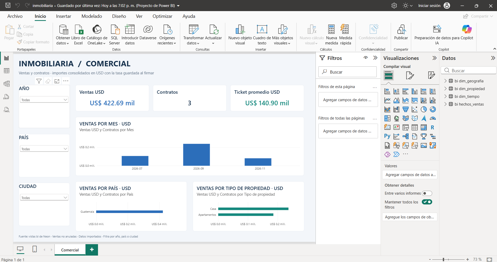
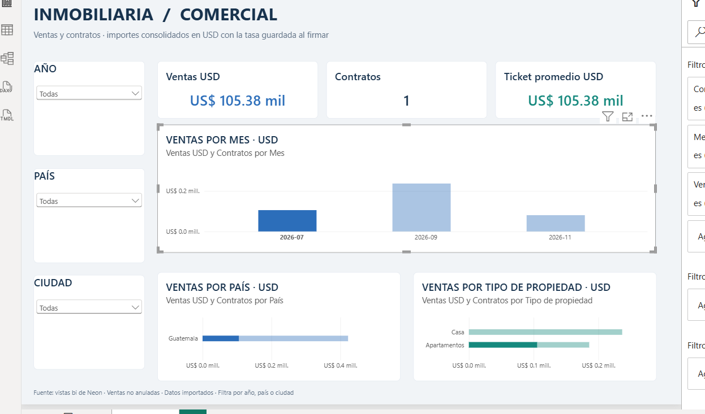
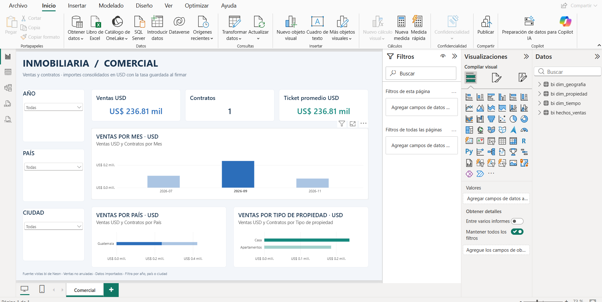
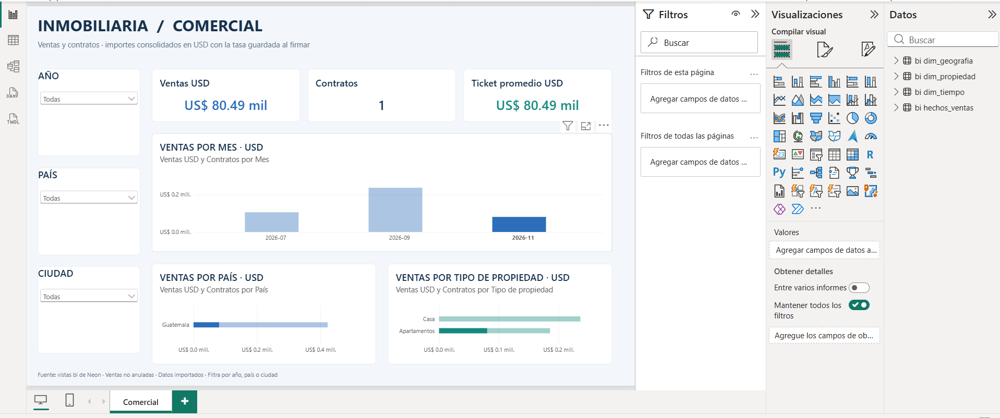
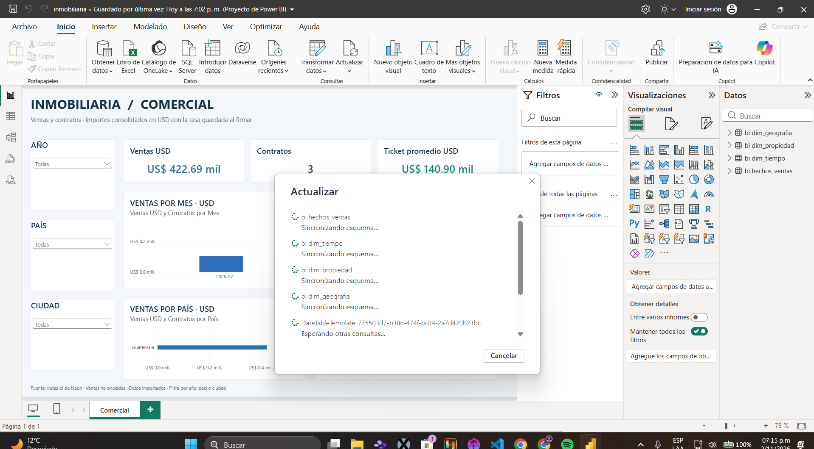

# Evidencia del tablero comercial · 2026-11-02

Nathaly conectó Power BI Desktop directamente a Neon con los datos recibidos
por privado de Douglas, cargó las cuatro vistas y abrió el proyecto editable.
Douglas informó que los permisos de `powerbi_reader` ya estaban comprobados
en producción. Codex no recibió ni versionó esa contraseña.

## Modelo y página

Cuatro tablas BI; relaciones activas de muchos-a-uno desde ventas a tiempo,
geografía y propiedad, con filtro unidireccional desde dimensiones. Las
tablas locales de fecha son las creadas automáticamente por Desktop.
Hay tres medidas: `Ventas USD`, `Contratos` y `Ticket promedio USD`.

La página **Comercial** tiene tres tarjetas, ventas por mes/país/tipo,
segmentadores de año/país/ciudad y notas de origen y conversión histórica.

## Prueba manual realizada por Nathaly

Las capturas originales se copiaron sin modificar desde sus archivos locales.
No contienen contraseñas. Se revisaron las siguientes interacciones:

| Contexto seleccionado en el gráfico | Contratos | Ventas USD mostradas | Ticket mostrado |
|---|---:|---|---|
| Sin selección | 3 | US$ 422.69 mil | US$ 140.90 mil |
| Julio de 2026 | 1 | US$ 105.38 mil | US$ 105.38 mil |
| Septiembre de 2026 | 1 | US$ 236.81 mil | US$ 236.81 mil |
| Noviembre de 2026 | 1 | US$ 80.49 mil | US$ 80.49 mil |

Los otros gráficos responden mediante selección/resaltado cruzado. Cada mes
tiene un contrato en esta muestra; por eso ventas y ticket coinciden al
seleccionarlo. Son cifras abreviadas por Desktop: no son importes exactos
para una conciliación contable ni deben sumarse después de redondearlas.

Nathaly ejecutó **Actualizar**, luego interactuó con el tablero y confirmó el
guardado final. La captura de actualización corresponde al proceso en curso;
por sí sola no prueba su finalización. Las capturas posteriores muestran
los visuales funcionando sin errores visibles.

Finalmente confirmó quitar la selección del mes, guardar y cerrar Desktop.
Se verificó el archivo `inmobiliaria.pbix`, de 117,366 bytes, con la página
Comercial y sus doce contenedores visuales. SHA-256:
`77c72c75d46609e2a5cd6e1b4c850bf0abae91b9d9cf5a3217ef834dff557127`.

## Verificaciones y límites

- Modelo editable deserializado con Microsoft.AnalysisServices 19.118.3:
  cuatro tablas BI, tres medidas y tres relaciones de estrella correctas.
- Antes de abrir en Desktop, los 16 documentos PBIR generados cumplieron los
  esquemas públicos de Microsoft. Desktop reescribió los visuales con la
  versión 2.14.0; su URL de esquema devolvía 404 al revisar, por lo que no se
  afirma una segunda validación de esquema de esa versión. Sí se comprobó
  JSON legible, estructura y ejecución visible en las capturas.
- Los cachés `.pbi/cache.abf` y ajustes personales `.pbi/localSettings.json`
  se excluyen de Git. Se entrega PBIP como fuente y PBIX como informe final.
- `conciliacion.sql` contiene las consultas de conteo, importes y claves
  huérfanas. **No se ejecutaron por Codex contra producción:** el acceso lo
  ingresó Nathaly en Desktop. El revisor debe comparar cifras exactas con
  esas consultas antes de dar por cerrada la conciliación SQL de producción.
- La revisión de R12 desde navegador y las treinta descargas del conjunto
  completo de reportes no se dan por realizadas por estas capturas de BI.
