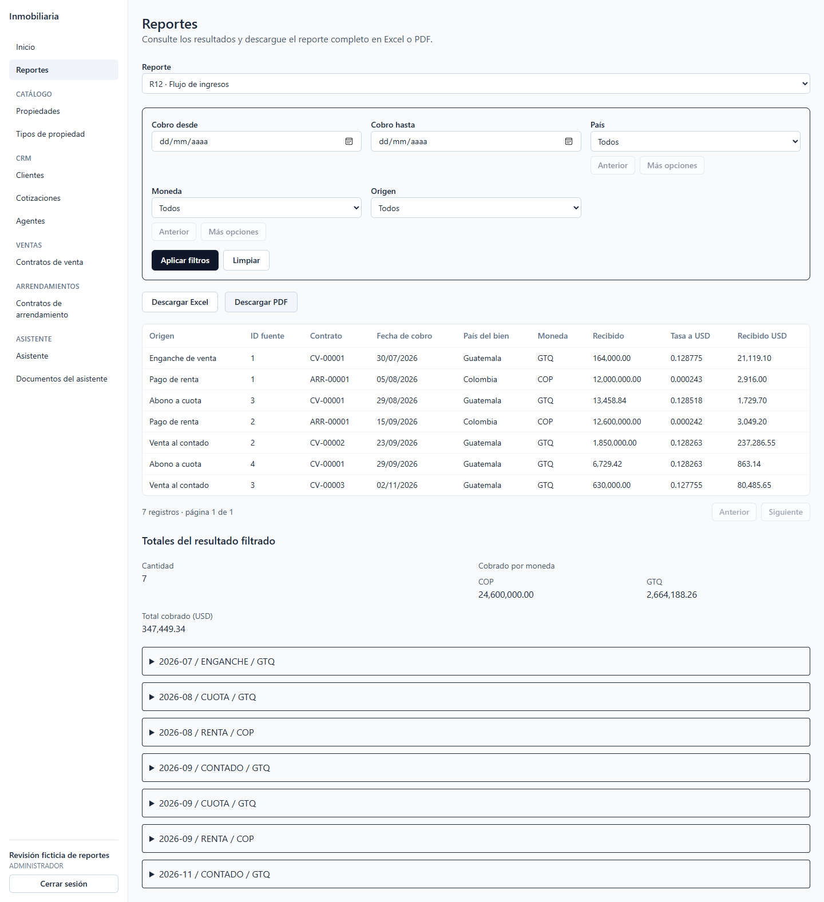
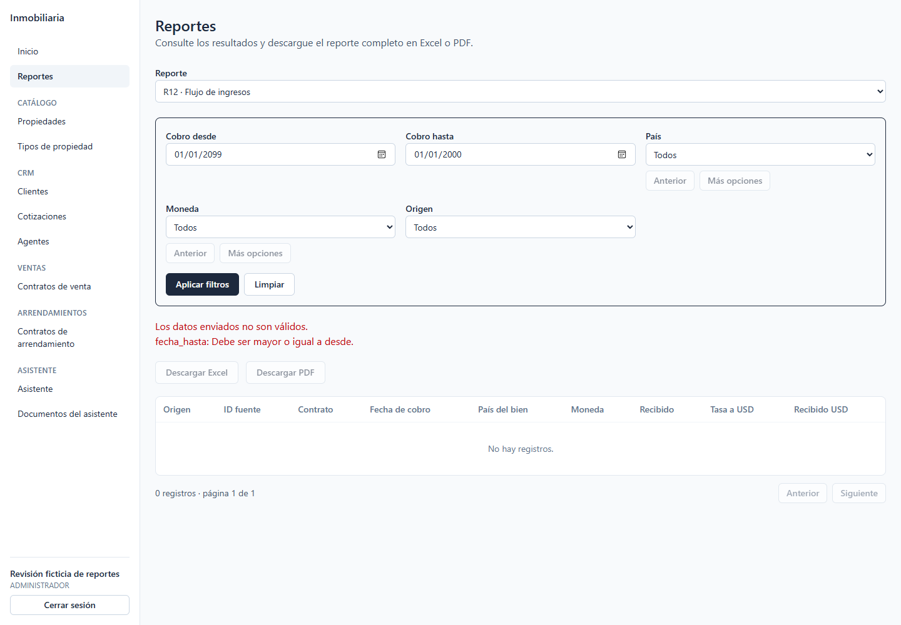
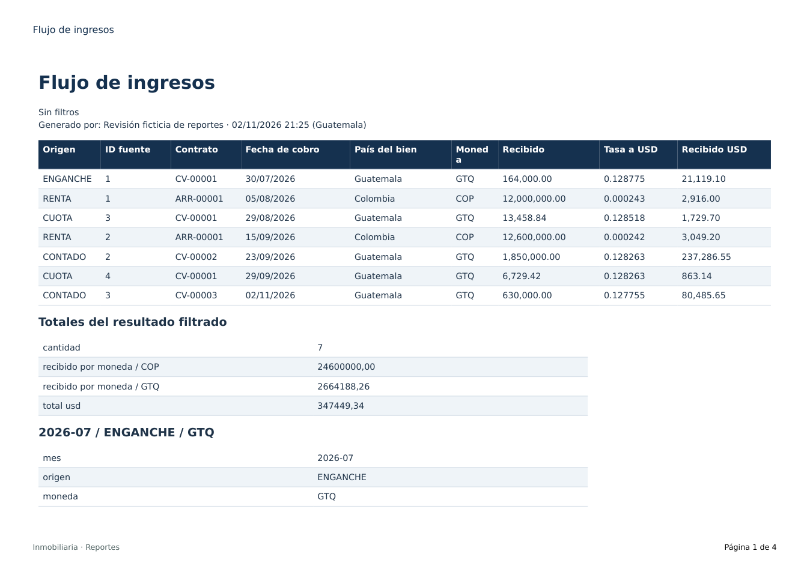
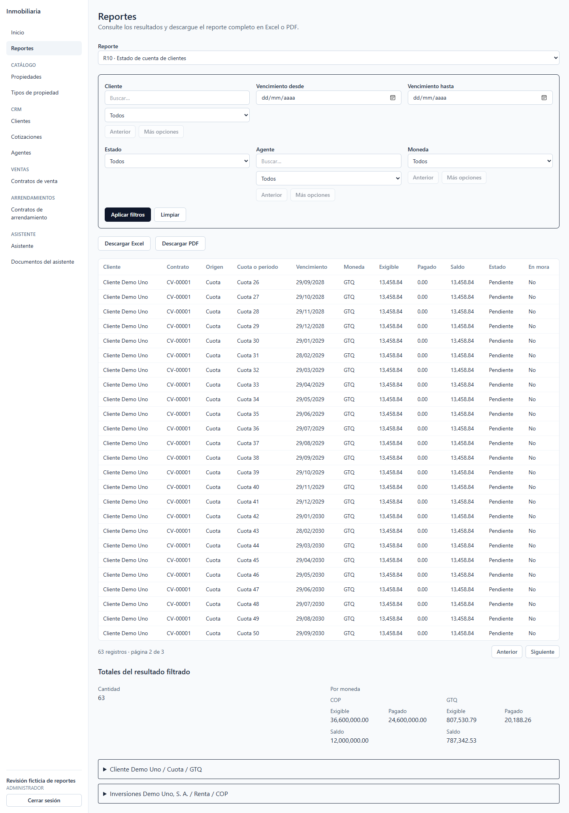

# Recorrido local de los quince reportes

Fecha: 2026-11-02 (Guatemala). Ejecución por Codex con Edge 156.0.4314.58
sin interfaz, mediante Playwright temporal, con React/Vite, Django y
PostgreSQL 16 locales. Se usó una cuenta ADMINISTRADOR y datos ficticios de
demostración. No se usaron credenciales de Neon ni datos de producción.
Las herramientas de automatización no se añadieron a las dependencias de
la aplicación.

## Resultados

Se inició sesión desde el formulario, se abrió `/reportes` y se eligió cada
entrada del catálogo. Para cada reporte se esperó su consulta y se pulsaron
los botones **Descargar Excel** y **Descargar PDF**. Los quince reportes
mostraron resultados o su estado vacío, sin alertas ni errores JavaScript;
las treinta descargas terminaron sin fallo y con contenido.

| Código | Reporte | Excel y PDF |
|---|---|---|
| R01 | Ventas por período | Correctos |
| R02 | Desempeño por agente | Correctos |
| R03 | Embudo de cotizaciones | Correctos |
| R04 | Ranking de clientes | Correctos |
| R05 | Inventario disponible | Correctos |
| R06 | Propiedades por estado | Correctos |
| R08 | Evolución de avalúos | Correctos |
| R10 | Estado de cuenta de clientes | Correctos |
| R11 | Morosidad | Correctos |
| R12 | Flujo de ingresos | Correctos |
| R13 | Compras por proveedor | Correctos |
| R14 | Ocupación de arrendamientos | Correctos |
| R15 | Avance y presupuesto de obra | Correctos |
| R16 | Documentos por vencer | Correctos, sin resultados en esta muestra |
| R17 | Bitácora de auditoría | Correctos |

Los saltos en los códigos pertenecen al alcance de la spec 021: el catálogo
contiene quince entradas, no diecisiete.

Se abrieron los quince Excel con openpyxl: contienen las hojas `Reporte`
y `Totales y grupos`. Se abrieron los quince PDF con un lector y se extrajo
texto de todas sus páginas. Se renderizaron las cuatro páginas de R12 y se
revisó visualmente su tabla; esta evidencia no afirma una inspección visual
de cada página de los quince PDF.

Registros completos: [descargas y filtros](resultados-navegador-021.json),
[lectura PDF](validacion-pdf-021.json) y [paginación](paginacion-021.json).
Los archivos de muestra completos se conservan localmente en la carpeta
ignorada `reportes_generados/revision-navegador-021`.

## R12: filtros, errores y precisión

La muestra general contiene siete cobros y 347,449.34 USD. Los filtros de
origen devolvieron dos CONTADO, un ENGANCHE, dos CUOTA y dos RENTA. Se
comprobó que cada fila recibida correspondiera al origen aplicado.

- `Cobro desde = 2099-01-01`: respuesta 200, sin filas.
- Fecha desde posterior a hasta: respuesta 400 y mensaje visible
  «fecha_hasta: Debe ser mayor o igual a desde».
- La tasa COP `0.000243` se muestra con seis decimales en pantalla y PDF;
  Excel conserva su valor numérico y formato `0.000000`.

El recorrido encontró que pantalla y PDF estaban usando dos decimales para
todas las columnas decimales. Se corrigieron para respetar `Columna.formato`,
que ya diferenciaba tasas e importes. No se modificaron los cálculos ni las
reglas de pagos. Después se repitió el recorrido completo de treinta
descargas. Se añadió una prueba de regresión con 12,000,000 COP y tasa
0.000243: la tasa permanece visible y el recibido USD es 2,916.00.

## Paginación y descarga completa

R10 contiene 63 filas en la muestra. Se pasó de página 1 a 2 y se comprobaron
25 filas en la segunda página, con idénticos totales. Desde allí se descargó
otro Excel y se abrió con openpyxl: contiene las 63 filas. **Limpiar** devolvió
la pantalla a página 1.

## Controles de la corrección

- `pytest apps/reportes/tests -q --tb=short`: **149 passed in 40.78s**.
- `ruff check .`: correcto; `ruff format --check .`: 333 archivos formateados.
- Migraciones: sin cambios; OpenAPI: sin avisos.
- Frontend: lint, typecheck y build correctos. Persiste el aviso de tamaño
  del paquete principal (710.87 kB, 213.41 kB con gzip).

La suite completa de 1,082 pruebas corresponde al commit previo. Para esta
corrección se ejecutó la suite del módulo afectado, que ahora incluye la
prueba nueva de precisión, además de los controles anteriores.

## Lo que esta evidencia no cierra

- La revisión de otro integrante sobre el commit de corrección.
- La comparación exacta del tablero con SQL en producción.
- La revisión de Douglas del tablero y del manual.
- Las pruebas manuales de todos los filtros y roles en el despliegue final.
  Aquí el recorrido de navegador usa ADMINISTRADOR; los cinco roles de R12
  se cubren en las pruebas de API del módulo.
- La explicación oral de Nathaly: se preparó una
  [guía de práctica](../guia-defensa-bloque-d.md), pero no se declara realizada
  su defensa ni su revisión individual del código.
